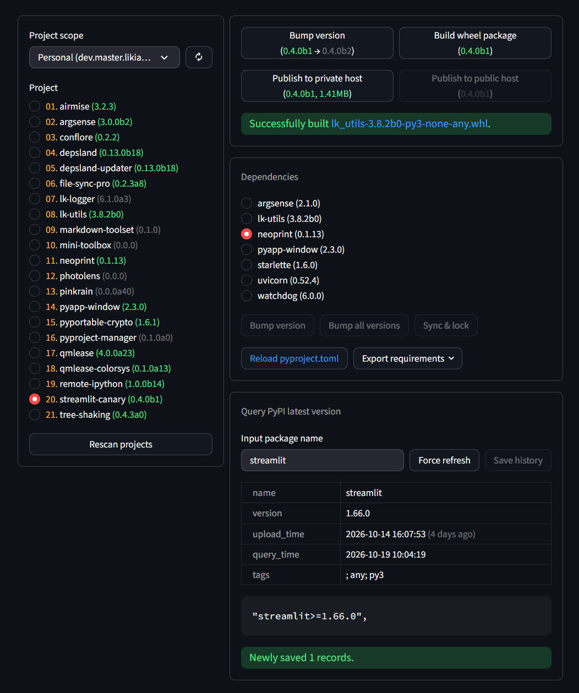
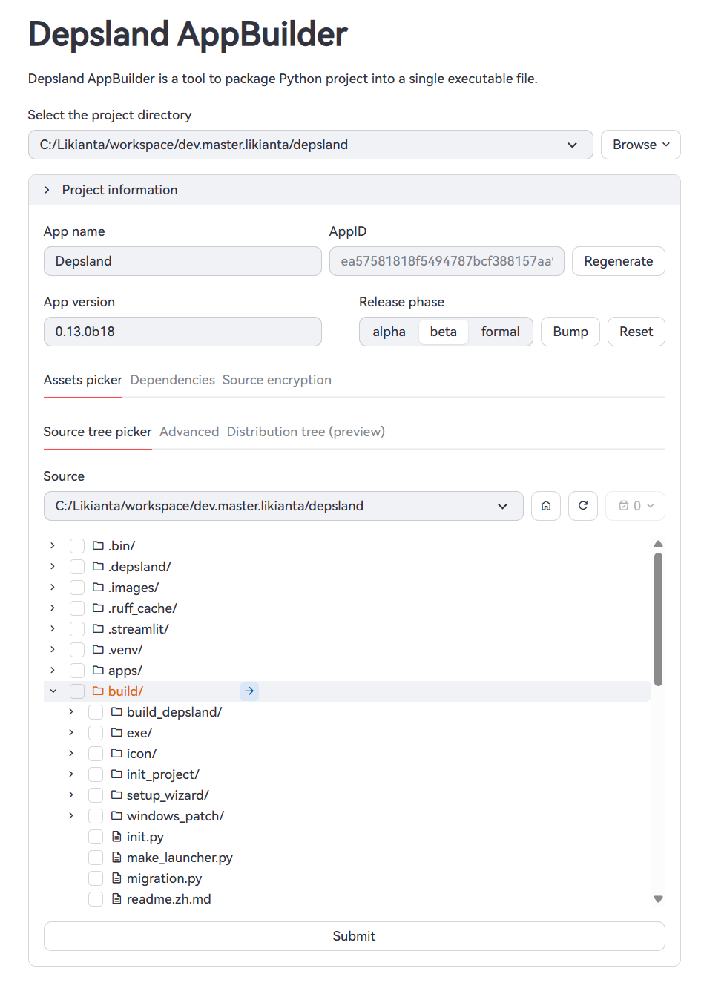

# Event-Driven Streamlit (No Reruns)

Streamlit's performance becomes a challenge as a project grows, especially
in scenarios that need low latency. A large part of that comes from its
rerun model, and another part comes from how hard it is to isolate the
performance-critical pieces of a script.

I wanted to remove the rerun and move to a signal-slot, event-driven design
inspired by QtQuick. This is a huge engineering effort, almost impossible for one person, so the idea I had since last year progressed on my own very slowly -- until I started using an AI Agent. Judging from the recent GitHub commit frequency, I succeeded.

It took me about a month (most of the work was actually done in the first week) to implement this feature. You can find the GitHub repository here: https://github.com/likianta/streamlit-canary (the docs: https://likianta.github.io/streamlit-canary/).

## Screenshots





## Highlights

- **Performance by design.** The app function runs once. The full component
  tree is rendered to the browser, and later interactions update only the
  affected components through patches.
- **Reactive, carefully polished syntax.** Signals, properties, and
  bindings are designed to read naturally and stay out of the way.
- **Desktop windows.** The app can start in a native window backed by Toga
  WebView, with a window icon, title, and adjustable size.
- **A built-in component library.** In addition to the Streamlit-style
  components, it adds folder trees, a PDF viewer, a live log panel,
  floating toasts, and more.
- **`dunder_literal`.** Enable it to stop Markdown from turning names such
  as `__init__` and `__name__` into bold text. `**name**` and `:bold[name]`
  still work for real emphasis.
- **Fewer dependencies.** Streamlit Canary does not pull in NumPy, pandas,
  SciPy, pyarrow, or Altair (including its `save` extra).

## Streamlit Canary vs Streamlit

### The entry point

Streamlit Canary:

```python
import streamlit_canary as sc

def setup_ui():
    ...

# streamlit-canary
if __name__ == '__main__':
    # python app.py
    sc.run(setup_ui, port=3001)
```

Streamlit:

```python
import streamlit as st

def setup_ui():
    ...

if __name__ == '__main__':
    # python -m streamlit run --runner.magicEnabled false --server.headless \
    #   true --server.port 3001 app.py 
    setup_ui()
```

The difference is not just the command. `sc.run` starts a persistent
runtime that owns the component tree. `streamlit run` starts a process
that re-executes the script on every interaction.

### Hello world

Streamlit Canary:

```python
import streamlit_canary as sc

def app():
    sc.PageTitle('Click Counter', default_theme='dark')
    
    cnt = sc.Property(0)
    
    with sc.Row('center'):
        sc.Text(sc.bind(cnt, lambda x: 'Click count: {}'.format(x)))
        #   when `cnt` changes, `sc.bind` emits new text to the Text component.

        with sc.Button('Increase counter', type='primary') as btn:
            @btn.on_click
            def _():
                cnt.set(cnt.get() + 1)

if __name__ == '__main__':
    # python app.py
    sc.run(app, port=3001)
```

Streamlit:

```python
import streamlit as st

def app():
    st.set_page_config('Click Counter')
    st.title('Click Counter')

    with st.container(horizontal_alignment=True, vertical_alignment='center'):
        text_place = st.empty()
        if st.button('Increase counter', type='primary'):
            st.session_state.count += 1
        with text_place:
            st.text('Click count: {}'.format(st.session_state.count))

if __name__ == '__main__':
    # python -m streamlit run \
    #   --runner.magicEnabled false \
    #   --server.headless true \
    #   --server.port 3001 \
    #   --theme.base dark \
    #   app.py
    app()
```

### Session state

Streamlit keeps state across reruns in `st.session_state`. Since the script
re-executes every time, any value that must survive has to live there.
Widgets synchronize with it through a `key` or their return value:

```python
import streamlit as st

if 'name' not in st.session_state:
    st.session_state.name = ''

st.text_input('Name', key='name')
st.text('Hello, {}'.format(st.session_state.name or 'stranger'))
```

Streamlit Canary uses `State` plus `Property`. The app function runs once,
and state is a long-lived reactive object. You can call `.get()` and
`.set()` on it, or bind it directly to a component:

```python
import streamlit_canary as sc

class State(sc.State):
    name = sc.Property('')

state = State()

def app():
    sc.TextInput('Name', sc.bbind(state.name))
    sc.Text(
        sc.bind(state.name, lambda x: 'Hello, {}'.format(x or 'stranger'))
    )
```

### Event handling

Every Streamlit interaction eventually becomes a rerun. You can test
`if st.button(...)` in the current run, or pass an `on_click` callback. The
callback runs before the rerun, but the script is still executed again in
full:

```python
import streamlit as st

if 'count' not in st.session_state:
    st.session_state.count = 0

def increase():
    st.session_state.count += 1

st.button('Increase counter', on_click=increase)
st.text('Click count: {}'.format(st.session_state.count))
```

Streamlit Canary models events as `Signal` objects. Components expose
signals such as `on_click`, `on_change`, and `on_submit`. A handler
registered with a decorator runs only when that event happens; the app
function is not called again:

```python
import streamlit_canary as sc

class State(sc.State):
    count = sc.Property(0)

state = State()

def app():
    with sc.Text('Click count: 0') as txt:
        @state.count.on_change.partial(sc._self)
        def _(count):
            txt.text.set('Click count: {}'.format(count.get()))

    with sc.Button('Increase counter') as btn:
        @btn.on_click
        def _():
            state['count'] += 1
```

Here `state.count.on_change` and `btn.on_click` are ordinary `Signal`
objects. They can be emitted manually, and several handlers can subscribe
to the same signal. `sc._self` and `sc._value` let a handler ask for the
owner or for its current value when the signal fires.

### More comparisons

**Layout.** Streamlit uses `st.columns`, `st.container`, `st.expander`, and
`st.tabs`. Canary maps those to `sc.Row`, `sc.Column`, `sc.Container`,
`sc.Expander`, and `sc.Tabs`. The tree is built once; later changes are
property updates:

```python
# Streamlit
left, right = st.columns(2)
with left:
    st.write('Left')
with right:
    st.write('Right')
```

```python
# Streamlit Canary
with sc.Row():
    with sc.Column(weight=1):
        sc.Text('Left')
    with sc.Column(weight=1):
        sc.Text('Right')
```

**Conditional UI.** In Streamlit this is usually an `if` branch. In Canary
the component is created once and shown or hidden through `visible`:

```python
# Streamlit
if st.toggle('Advanced'):
    st.text_input('Extra option')
```

```python
# Streamlit Canary
advanced = sc.Toggle('Advanced')
with sc.Container(visible=advanced.value, animated=True):
    sc.TextInput('Extra option')
```

**Desktop windows.** `sc.run(..., show_window=True)` opens the app in a
native window, with no browser involved:

```python
sc.run(app, show_window=True, window_size=(980, 760))
```

To be fair: Streamlit's ecosystem is more mature and covers more of the
component surface. Canary is still at v0.4.x, and some official components
(for example, the chart suite) are still being ported. If a project depends
on mature facilities such as `st.cache_data` or `st.file_uploader`, check
whether an equivalent already exists before switching.

## Install

```bash
pip install streamlit-canary
```

Requires Python 3.11 or higher version.

## Quick start

```python
import streamlit_canary as sc

class State(sc.State):
    count = sc.Property(0)

state = State()

def app():
    sc.PageTitle('Click Counter')

    with sc.Row('center'):
        with sc.Text('Click count: 0') as txt:
            @state.count.on_change
            def _():
                txt.text.set('Click count: {}'.format(state.count.get()))

        with sc.Button('Increase counter', type='primary') as btn:
            @btn.on_click
            def _():
                state.count.set(state.count.get() + 1)
                # or a shorthand form: state['count'] += 1

if __name__ == '__main__':
    sc.run(app, port=2201)
```

Read the [user manual](https://likianta.github.io/streamlit-canary/) for
the full API reference.
